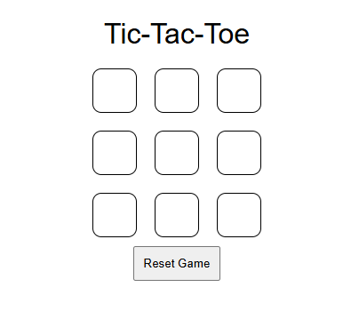

# Tic-Tac-Toe

A classic Tic-Tac-Toe game built with React.



## Description

A simple implementation of the classic Tic-Tac-Toe game for two players. Players take turns placing X and O on a 3x3 grid. The first player to align three symbols horizontally, vertically, or diagonally wins.

## Features

- Two-player game (X and O)
- Winner detection
- Draw detection
- Game reset button

## Technologies

- React 19
- Vite
- CSS

## Installation and Setup

1. Clone the repository
2. Install dependencies:

```bash
npm install
```

3. Start the application:

```bash
npm run dev
```

## Game Rules

1. Player X goes first
2. Players take turns clicking on empty cells
3. The first player to align three symbols in a row wins
4. If all cells are filled with no winner, it's a draw

## Project Structure

```
react-ttt-game/
├── public/
│   └── image.png
├── src/
│   ├── App.jsx       # Main game component
│   ├── App.css       # Game styles
│   ├── index.css     # Global styles
│   └── main.jsx      # Entry point
├── index.html
├── package.json
└── vite.config.js
```
